# cardputer-adv

Tooling to streamline getting new firmware onto an M5Stack Cardputer ADV: fetch the latest firmware release(s), stage the `.bin` file(s) the way the device expects, and have them ready to drop onto the SD card — without the manual "browse M5Burner's cache, rename the file, drag it into `downloads`" dance described in [ADR 0001](adr/0001-porkchop-firmware-setup-macos.md).

## Status

Early / placeholder. No code yet — currently just the ADR documenting the manual macOS setup process this project intends to automate.

## Premise

Right now, getting a new firmware build onto the Cardputer ADV means:
1. Finding the newest release for a given firmware (e.g. Porkchop) and confirming it's from the real author.
2. Downloading it via M5Burner (or a browser), then digging it out of M5Burner's macOS cache directory.
3. Renaming the `.bin` file to something identifiable.
4. Mounting the SD card, finding/creating the `downloads` folder, dragging the file in, ejecting properly.

The goal of this project is to collapse that into a single step (or a short script) on macOS: point it at a firmware source, get back a correctly named `.bin` file sitting in a local staging folder ready to copy to the SD card's `downloads` directory.

## Docs

- [`NOTICE.md`](NOTICE.md) — license and exact upstream source for every firmware binary in `firmware/`.
- [`adr/`](adr/) — architecture decision records. Start with [0001 — Porkchop Firmware Setup Workflow (macOS)](adr/0001-porkchop-firmware-setup-macos.md) for the manual process this project is meant to streamline.

<!-- org-footer -->
---

Part of <a href="https://github.com/m5stack-lab">m5stack-lab</a> · unofficial M5Stack projects, not affiliated with M5Stack · built by <a href="https://github.com/ry-ops">ry-ops</a>

